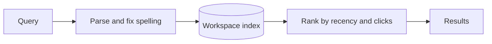

# Search beta launch review

The search beta reached 4,210 invited users in three weeks. Most of them tried a search, and a third came back the next week. We recommend opening the beta to every workspace on December 1.

## Funnel

<!-- island funnel -->
| Stage | Users |
|---|---|
| Invited | 4,210 |
| Tried a search | 3,180 |
| Searched again in week 2 | 1,420 |
| Saved a search | 610 |

*The biggest drop is between the first search and the second week, so onboarding is where the next sprint goes.*

## How search answers a query

*Ranking is the only step that learns from clicks, so it is where short queries get better.*

## Rollout

<!-- island rollout -->
| Stage | Audience | Gate | Date | Status |
|---|---|---|---|---|
| Internal dogfood | 120 | No P1 bugs for a week | 2026-10-06 | Done |
| Invite-only beta | 4,210 | Error rate under 0.5% | 2026-10-20 | Done |
| Every workspace | 38,000 | Week-2 return above 30% | 2026-12-01 | Next |
| Search on by default | 52,000 | Saved-search alerts shipped | 2027-01-12 | Planned |

*Each stage opens only when the gate before it holds for a week.*

## Next steps

Ship saved-search alerts before the wider rollout, since they bring people back in week two. The open questions from the team are in the [retro notes](notes/retro.md).
