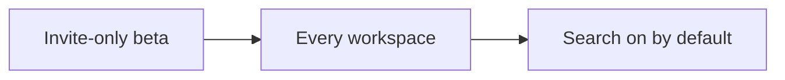

# Search beta launch review

The search beta reached 4,210 invited users in three weeks. Most of them tried a search, and a third came back the next week. We recommend opening the beta to every workspace on December 1.

## Funnel

<!-- island funnel -->
| Stage | Users |
|---|---|
| Invited | 4,210 |
| Tried a search | 3,180 |
| Searched again in week 2 | 1,420 |
| Saved a search | 610 |

*The biggest drop is between the first search and the second week, so onboarding is where the next sprint goes.*

## Rollout

*Each step waits for a week of error rates under 0.5%.*

## Next steps

Ship saved-search alerts before the wider rollout, since they bring people back in week two. The open questions from the team are in the [retro notes](notes/retro.md).
