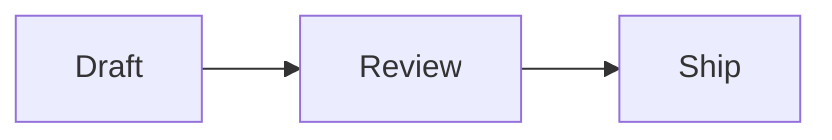

# Mermaid diagrams

Read this before you draw a diagram as a `mermaid` fence. The fence renders when `margent` renders the doc, into inline SVG that follows the page theme. Nothing runs in the page. GitHub also renders the fence, with its own colours.

## Diagram types

These types render well in margent:

- `flowchart`: a pipeline, a request path, a decision.
- `sequenceDiagram`: messages between processes or people, in order.
- `stateDiagram-v2`: states and the transitions between them.
- `erDiagram`: entities and how they relate.
- `classDiagram`: types and how they relate.
- `gantt`: a plan with dates.
- `timeline`: dated events in order.
- `mindmap`: a breakdown from one topic.
- `pie`: a few shares of one whole. Not for numbers people check.
- `quadrantChart`: a few items placed on two axes, to make one point.
- `xychart-beta`: a small bar or line chart. Not for numbers people check.

`margent check` reports a type it can't draw as `mermaid unsupported-diagram`. Prefer the types above.

## Colour

Colour a node with a named style. The styles come from the page tokens, so they follow the theme:

- `:::accent` on the node: `review[Review]:::accent`
- a `class` line: `class review,signoff accent`

The names:

- `accent`: the one thing the reader should look at.
- `muted`: context that is out of scope.
- `go`, `warn`, `stop`, `done`: status tones. Use them only to show a status.

Use one accent per diagram at most, and leave the other nodes plain.

Don't write hex colours, `classDef`, `style` lines or theme settings (`%%{init}%%`). They render as written, so they bypass the theme and break dark mode.



## Width

The wide layout must fit in 1200 px. The page column is 900 px, and text may shrink to 75% in it. `margent check` fails a wider diagram with:

`diagram is {w}px wide, so its text would shrink below 75% in the page column: split it, turn it top-to-bottom, or draw it as an SVG`

The usual causes:

- A sequence diagram with many participants. Twenty participants with long names came to 1505 px.
- A `flowchart TD` where one node has about seven children side by side, with long labels.

Fix it in this order:

1. Shorten the labels.
2. Group children in a `subgraph`, or show fewer of them.
3. Split the diagram in two, one for each part of the story.
4. Turn it the other way: `flowchart TD` to `LR`, or the reverse. A flow that is too wide turns top-to-bottom on its own.
5. Draw it as an SVG (tier 2 in SKILL.md).

The narrow layout is for phones. It may scroll sideways, and `check` doesn't fail on that.

## Charts

Numbers people check, compare or comment on stay in a markdown table, with an island over it (see "When an island earns its place" in SKILL.md). Benchmarks, costs and results are never an `xychart-beta` or a `pie`.

A pie of a few shares, or a quadrant that makes a point about positioning, is fine as Mermaid.

## Comments

A diagram is a block. A block comment line directly after the closing fence comments on the whole diagram. Put the caption after that line:

````md

{>>[c4] Quy: "Review" → is this the only gate?<<}

*Review is the one gate before shipping.*
````

In a served page, selecting a label's text and commenting makes a block comment that quotes the label. The quote must appear in the diagram. When it repeats, add `#n`: `"Review" #2 → …` is the second `Review` in reading order. Don't put comment markup inside the fence.

## Errors and links

- An error points at a line inside the fence: `{file}:{line}: mermaid {code}: {message}`. Codes are `syntax`, `semantic`, `limit` and `unsupported-diagram`. Fix the source at that line.
- A link in a diagram (`click A "https://…"`) must be an absolute `http`, `https` or `mailto` URL. A relative link is a check error. Link other docs from the caption instead.
- Caption every diagram: one italic sentence after the fence (after any comment line), stating what the reader should take from it.
- After you write a diagram, run `margent open` and look at it, as SKILL.md says.
