# Diagrams

One diagram of each type pele draws, all synthetic.

## Flow

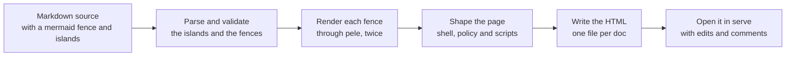

*A left-to-right flow that is too wide for the page column, so the wide layout turns it top-to-bottom.*

## Sequence

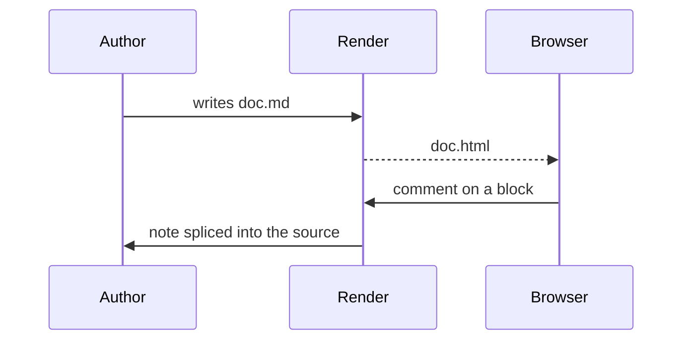

*Who sends what between the author, the renderer and the browser.*

## State

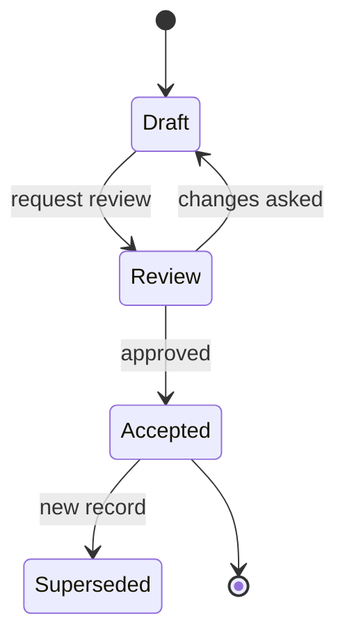

*A record's life, with the review step in the accent colour and the accepted step in the go tone.*

## Entities

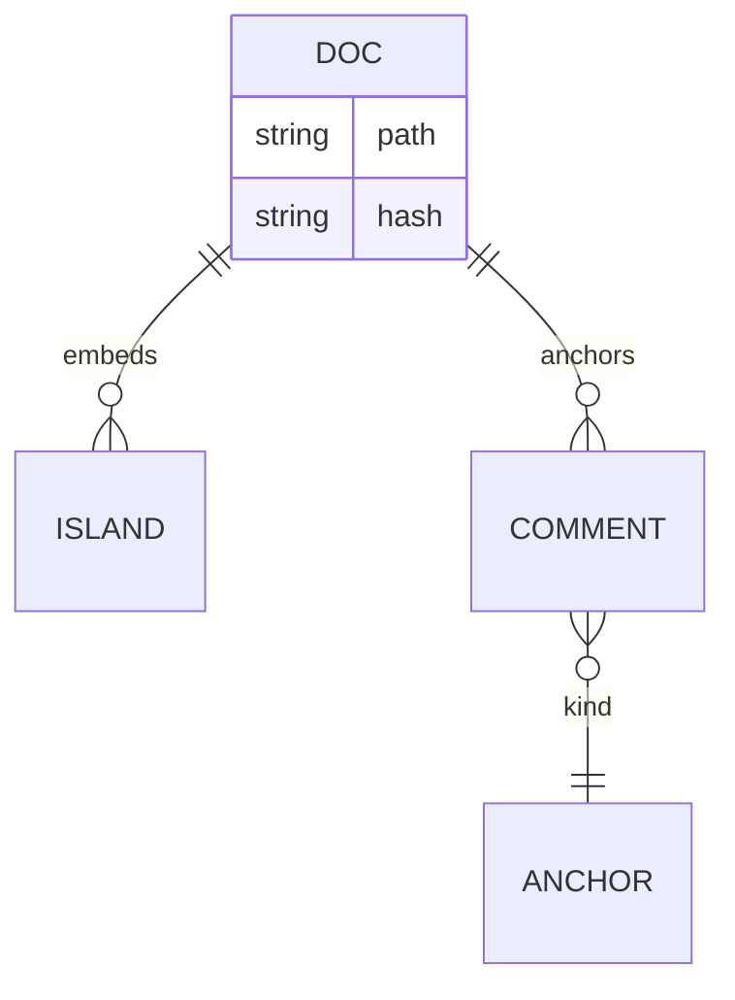

*The records a doc holds: its islands, its comments, and what each comment anchors to.*

## Classes

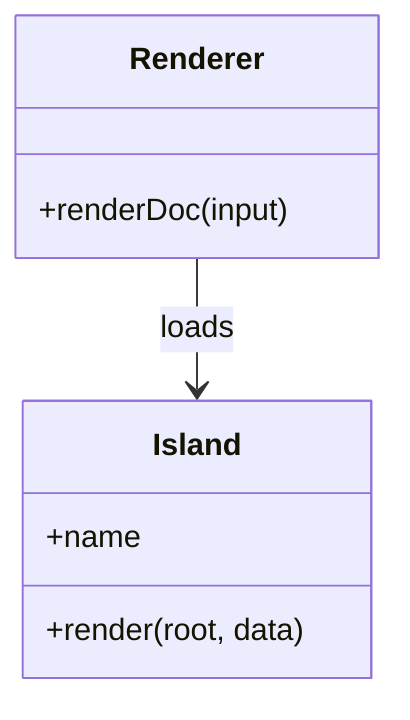

*Two classes and the one dependency between them.*

## Gantt

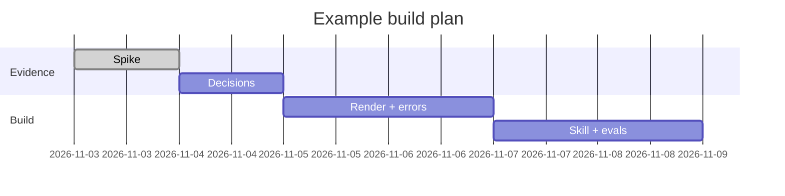

*Three phases, one after another, with the first already done.*

## Timeline

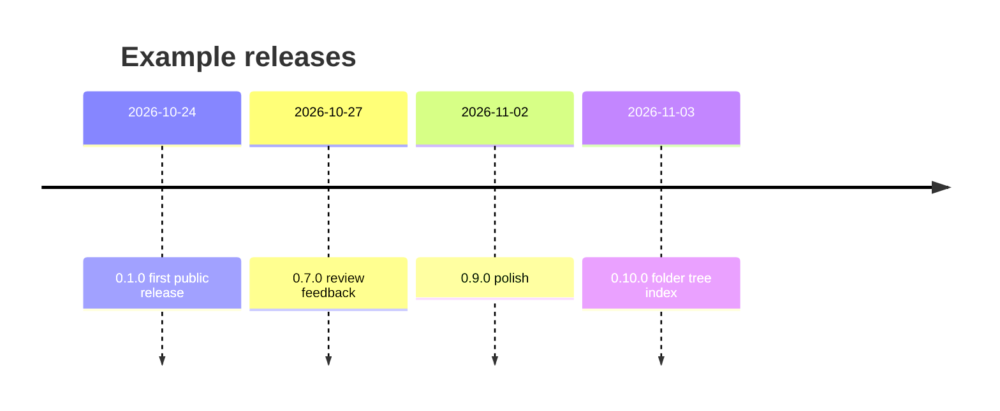

*Releases in date order, one line each.*

## Mind map

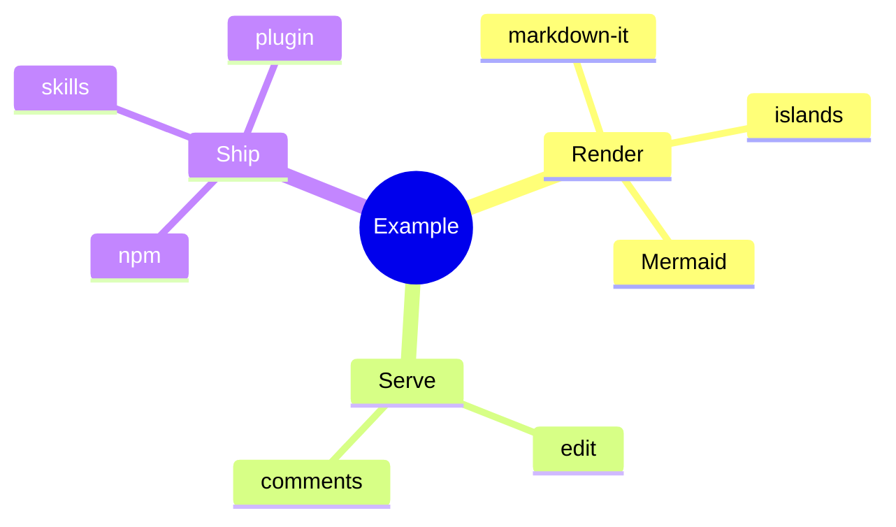

*The parts of the project, grouped under three branches.*

## Pie

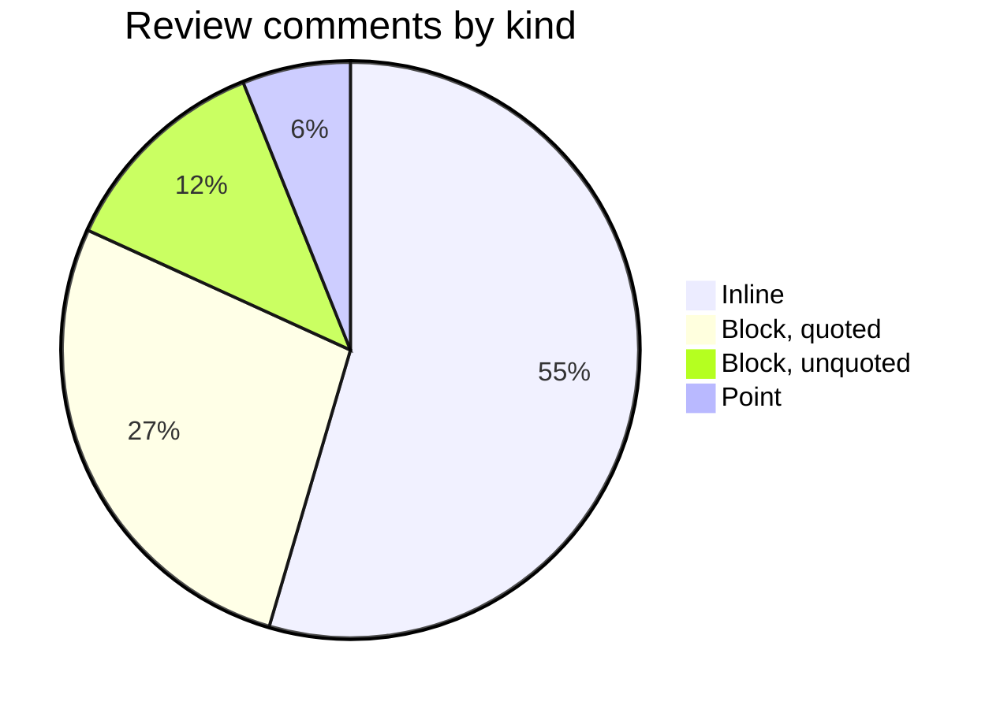

*How the comments in one review were anchored.*

## Quadrant

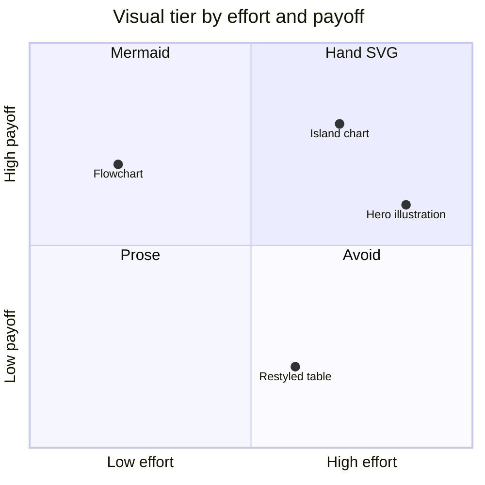

*Where each kind of visual sits on effort and payoff.*

## Chart

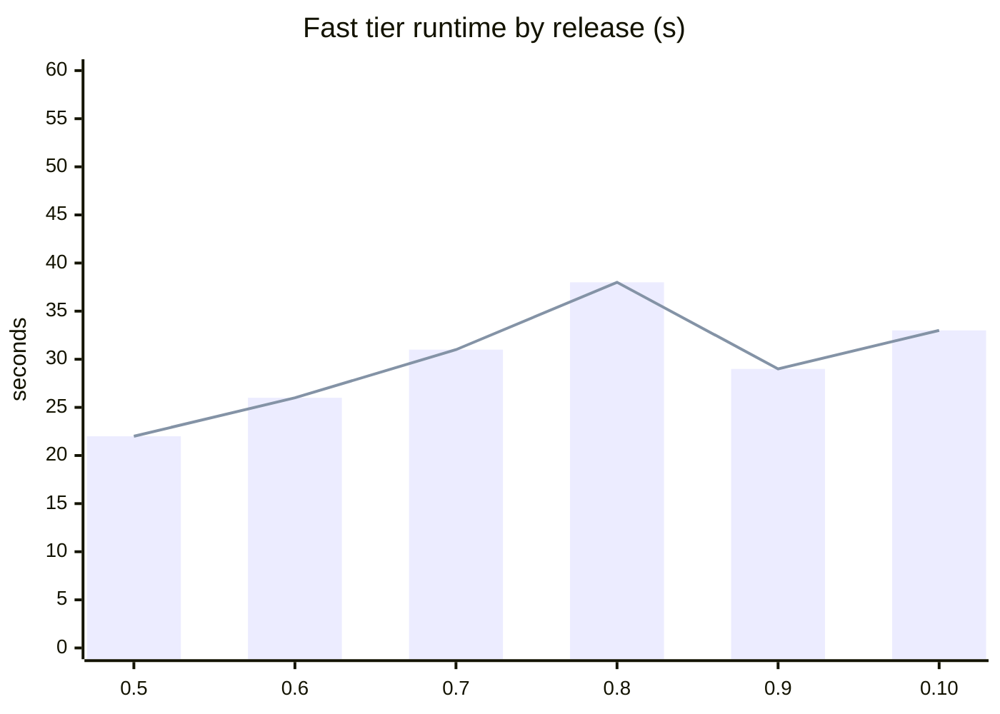

*A bar and line chart of one number over six releases.*
